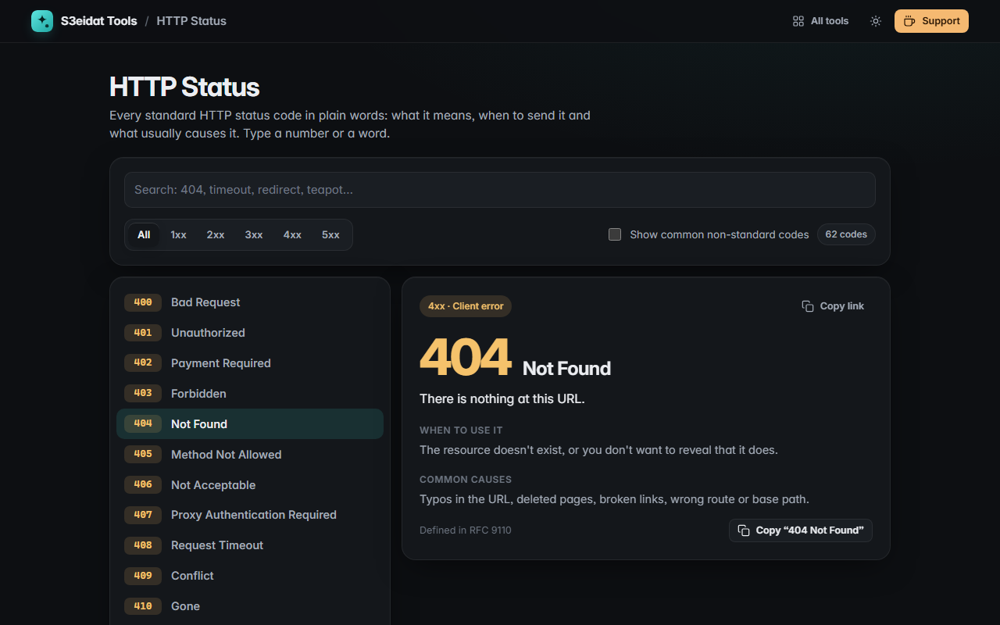

# HTTP Status

> Every HTTP status code, explained simply: what it means, when to use it and what usually causes it. Free, private, and it works offline.

### ▶ [Open HTTP Status](https://s3eidat.github.io/http-status/)



## Features

- All **62 standard status codes** (1xx–5xx), including WebDAV and newer ones like 103, 425 and 451
- For each: a **plain explanation**, **when to use it**, **common causes** and the defining RFC
- **Search** by number (`50` lists 500–508) or by words (`timeout`, `cache`, `redirect`)
- **Filter by class**: 1xx, 2xx, 3xx, 4xx, 5xx
- Optional **non-standard codes** you meet in logs: nginx 499 and Cloudflare 520–524 (clearly marked)
- **Deep links**: open `#404` or `#503` directly, and copy a link to any code
- Keyboard friendly: Enter picks the first match, arrow keys move through the list

## Privacy

Your searches never leave your device. There is no server, no account, no analytics.
The page ships with a strict Content-Security-Policy (`connect-src 'self'`), so the browser
itself blocks any attempt to send data anywhere.

## Run it yourself

It's plain HTML, CSS and JavaScript with no build step:

```bash
git clone https://github.com/s3eidat/http-status
cd http-status
python -m http.server 8000
```

Then open http://localhost:8000.

## Support

If this saved you time, **[buy me a coffee ☕](https://s3eidat.github.io/coffee/)**. It keeps every tool free.

---

Part of **[S3eidat Tools](https://s3eidat.github.io/)**: 100+ free, private tools that run in your browser. MIT licensed.
